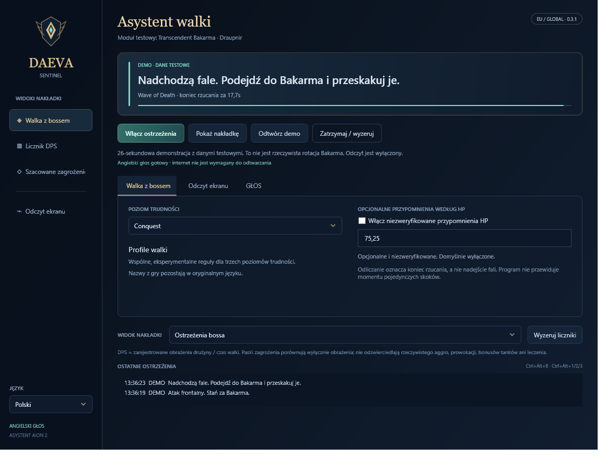
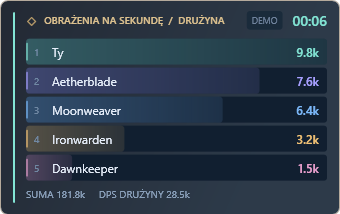

# Daeva Sentinel

A Windows companion for AION 2 with spoken Bakarma warnings, a movable in-game overlay, party DPS and an experimental threat view.

**[Download the launcher](https://github.com/Azuuki69/daeva-sentinel/releases/latest)** · [Releases](https://github.com/Azuuki69/daeva-sentinel/releases)





## Start playing

1. Download **Daeva-Sentinel-Launcher** from Releases and extract the complete ZIP into a writable folder.
2. Run **Daeva Sentinel Launcher.exe**. Choose English or Polski and click **Launch companion**. Updates are checked and installed before launch; existing settings are preserved.
3. Choose network events, screen capture, or both. Network events require [Npcap](https://npcap.com/#download), installed separately.
4. For screen recognition, click **Calibrate screen** while Aion 2 is running in windowed/borderless mode. Select the boss-name region, then the cast-name region. Recognition uses the English text visible in those regions.
5. Start live alerts before entering Draupnir. Click **Show overlay**, drag it into position, then **Lock** for click-through.

**Ctrl+Alt+B** shows/hides the overlay; showing it unlocks it. **Ctrl+Alt+M** mutes voice. **Ctrl+Alt+1 / 2 / 3** switches Boss / DPS / Threat while locked.

## English / Polski

The app, launcher and overlay support English and Polish. **Skill, boss, dungeon, mode, class, item and player names remain in their original game language. All spoken callouts remain English.** English neural voice clips are bundled and play locally.

Wybierz **Polski** w launcherze lub aplikacji. Interfejs i instrukcje zostaną przetłumaczone, ale nazwy z gry pozostają oryginalne. Głos zawsze pozostaje angielski. Nakładkę można przesuwać po odblokowaniu; zablokowana przepuszcza kliknięcia do gry.

## What the data means

- Network input provides parsed casts, timing, boss targeting and recorded party damage. The parser is the pinned MIT-licensed [Aion-DPS-Meter](https://github.com/SkeeveAN/Aion-DPS-Meter).
- Screen input locally recognizes Bakarma's name and known ability names in two agreeing frames. It does not infer target identity, an exact cast duration or individual jump timings. Screenshots stay in memory; they are not uploaded or saved by ordinary recognition.
- Duplicate screen/network detections of the same cast produce one callout. The overlay identifies NET, SCREEN or BOTH.
- DPS is recorded party damage divided by encounter elapsed time. Party membership must be visible to the parser; otherwise only identified own damage is counted.
- **The threat panel is a damage-only proxy, not the game's actual enmity table.** It does not model taunts, healing threat or tank modifiers. The boss-target indicator is separate and can also reflect a special ability's target, rather than sustained aggro.
- Exploration, Conquest and Conquest Hard have selectable profiles with shared experimental cast rules. HP preparation is off by default because guide thresholds disagree.

This is an experimental first public build. Automated decoder, OCR, fusion, meter and updater tests pass; actual European Bakarma encounters still need live validation. Demo screenshots contain synthetic names and numbers. This app is not affiliated with NCSOFT, Questlog, Shugo or DBM.

## Updates and rollback

The launcher reads a small GitHub Releases manifest, verifies its RSA-PSS publisher signature, downloads the declared package over HTTPS, and checks its signed size and SHA-256 before extracting it into a new version folder. Unsafe archive paths are rejected. The active version pointer is switched only after extraction completes. **Rollback** selects the previous installed version. Settings are stored in the shared `data` folder.

The companion does not upload combat logs or game screenshots. Local diagnostic logs contain mechanic identifiers, timestamps and warning texts. The launcher makes ordinary HTTPS requests to GitHub for updates.

## Build

Windows x64, .NET 10 SDK, Git and PowerShell 7 are required. Run:

```powershell
./scripts/Build.ps1
```

This retrieves a pinned copy of the parser, runs the tests and builds the launcher with the companion bundled. English OCR and voice assets are included in the source tree.

To publish a new release, push a `vX.Y.Z` tag. The release workflow builds and signs the update using the repository's `UPDATE_SIGNING_KEY` secret. The private key must never be committed. Maintainers can also run `scripts/Publish.ps1` locally with a private signing-key file. The bundled public key must remain stable for existing launchers to trust subsequent updates.

## Credits

See [THIRD-PARTY-NOTICES.txt](THIRD-PARTY-NOTICES.txt). Parser code is MIT, Tesseract and its English OCR model are Apache-2.0, and the bundled English clips were generated with the public LJ Speech Piper model. Game names and data belong to their respective owners.
